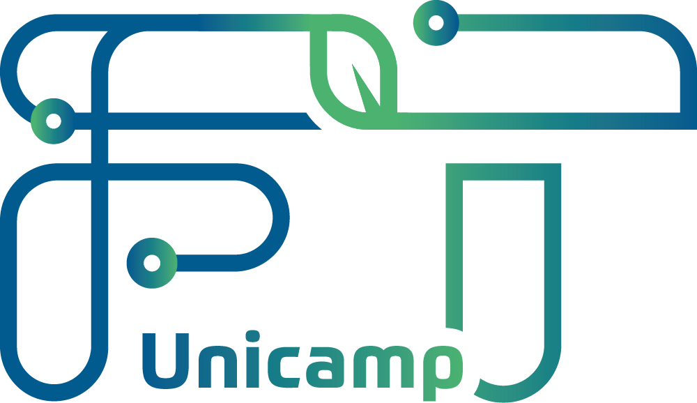

<p align="center">
  
  
</p>

<h1 align="center">💰 FT Coin</h1>

<p align="center">
  <strong>Projeto desenvolvido para as disciplinas SI300 e SI400 – Programação Orientada a Objetos I e II</strong><br>
  Faculdade de Tecnologia da Universidade Estadual de Campinas (FT/UNICAMP)
</p>

---

## 📖 Sobre o projeto

O **FT Coin** é um sistema de acompanhamento de carteira de moedas virtuais, com o objetivo de apurar saldos, custo médio ponderado, ganhos e perdas ao longo do tempo.  
O sistema foi desenvolvido em **Java (JDK 17+)** utilizando **Apache Maven (`poo.xml`)** e permite que o usuário realize operações de **gerenciamento de carteiras, registro de movimentações e geração de relatórios financeiros**.

Este projeto aplica arquitetura **MVC**, padrões de projeto (**Singleton**, **Abstract Factory** e **DAO**), internacionalização dinâmica (**I18n** em Português, Inglês e Espanhol), cache em memória para consultas de cotações e cobertura de testes automatizados com **JUnit 5**.

---

## ⚙️ Funcionalidades principais

- 💼 **Gerenciamento de carteiras** (inclusão, consulta, edição e exclusão)  
- 💱 **Registro de movimentações** (compra e venda com validação cronológica de saldo)  
- 📊 **Relatórios financeiros** (saldo atual, histórico cronológico, ganho/perda realizado e a mercado)  
- 🔍 **Listagem de carteiras** (ordenadas por identificador ou alfabeticamente por titular)  
- 🌐 **Integração com Oráculo e Cache** (consulta remota via Socket TCP e cache em memória)  
- 🌍 **Internacionalização (I18n)** (detecção automática de `Locale` e alternância dinâmica entre PT, EN e ES)  
- ❓ **Ajuda e créditos do sistema**

---

## 🧠 Requisitos não funcionais e arquitetura

- **Usabilidade:** interface de linha de comando (CLI) organizada com suporte a UTF-8  
- **Desempenho:** cache thread-safe (`ConcurrentHashMap`) para evitar requisições redundantes ao Oráculo  
- **Confiabilidade:** integridade referencial e precisão monetária com `BigDecimal`  
- **Portabilidade:** compatível com Java 17 ou superior e Maven  
- **Padrões de Projeto:** MVC, DAO, Abstract Factory (`DAOFactory`) e Singleton (`DatabaseConnection`)  

---

## ⚙️ Fluxo geral do sistema

1. O programa inicia executando a classe principal (`br.ftcoin.Main`), detectando o idioma padrão do sistema (`Locale.getDefault()`) e exibindo o **menu principal**.  
2. O usuário escolhe uma das opções:
   - Gerenciar carteiras  
   - Registrar movimentações  
   - Consultar relatórios  
   - Acessar ajuda e créditos  
   - Alterar idioma  
3. Os dados podem ser persistidos em:
   - **Memória local** (`MEMORIA`) — armazenamento volátil em memória  
   - **Banco de dados relacional** (`MARIADB`) — persistência remota no servidor MariaDB  

---

## 🔐 Configuração das credenciais (Banco de Dados)

Por questões de segurança, o usuário e a senha do servidor remoto não ficam salvos no código-fonte.  
Antes de executar o sistema no modo **MariaDB**, crie um arquivo chamado **`mariadb.env`** na raiz do projeto (mesmo nível do `poo.xml`) com o seguinte conteúdo:

```env
MARIADB_USER=seu_usuario_aqui
MARIADB_PASSWORD=sua_senha_aqui
```

> ⚠️ Os arquivos `.env` são ignorados pelo Git (`.gitignore`) e não devem ser versionados.

---

## 🛠️ Compilação, Execução e Testes

O projeto utiliza o arquivo de build **`poo.xml`** com **Apache Maven**. Todos os comandos abaixo devem ser executados a partir da **raiz do repositório**.

### 1. Compilação completa

Para limpar builds anteriores e compilar todo o código-fonte e as classes de teste:

```bash
mvn -f poo.xml clean test-compile

```

### 2. Execução do programa

#### ▶️ Modo em Memória (padrão)

```bash
mvn -f poo.xml org.codehaus.mojo:exec-maven-plugin:3.5.0:java "-Dexec.mainClass=br.ftcoin.Main" "-Dexec.args=MEMORIA"

```

#### 🗄️ Modo Banco de Dados (MariaDB)

```bash
mvn -f poo.xml org.codehaus.mojo:exec-maven-plugin:3.5.0:java "-Dexec.mainClass=br.ftcoin.Main" "-Dexec.args=MARIADB"

```

#### 🌍 Iniciar diretamente em outro idioma (`Locale.getDefault()`)

Para iniciar a JVM já configurada em **Inglês** ou **Espanhol** (além da troca dinâmica disponível no próprio menu do sistema):

* **Inglês (`en-US`):**
```bash
mvn -f poo.xml org.codehaus.mojo:exec-maven-plugin:3.5.0:exec "-Dexec.executable=java" "-Dexec.args=-Dfile.encoding=UTF-8 -Duser.language=en -Duser.country=US -cp %classpath br.ftcoin.Main MEMORIA"

```


* **Espanhol (`es-ES`):**
```bash
mvn -f poo.xml org.codehaus.mojo:exec-maven-plugin:3.5.0:exec "-Dexec.executable=java" "-Dexec.args=-Dfile.encoding=UTF-8 -Duser.language=es -Duser.country=ES -cp %classpath br.ftcoin.Main MEMORIA"

```


* **Português (`pt-BR`):**
```bash
mvn -f poo.xml org.codehaus.mojo:exec-maven-plugin:3.5.0:exec "-Dexec.executable=java" "-Dexec.args=-Dfile.encoding=UTF-8 -Duser.language=pt -Duser.country=BR -cp %classpath br.ftcoin.Main MEMORIA"

```


> 💡 **Dica para terminal Windows (PowerShell):** caso caracteres acentuados não apareçam corretamente, execute `chcp 65001` antes de rodar o programa.

### 3. Execução da suíte de testes unitários

Para rodar todos os testes automatizados (**JUnit 5**):

```bash
mvn -f poo.xml test

```

### 4. Geração da documentação Javadoc

Para gerar a documentação HTML completa das classes e interfaces:

```bash
mvn -f poo.xml javadoc:javadoc

```

---

## 👥 Colaboradores

* **Ana Julia Bandeira Maximo** — RA: 219528
* **Bárbara Helóra Nigra Táparo** — RA: 270483
* **Beatriz Moreira Cavalcanti** — RA: 222087
* **Raíssa Souza Santos** — RA: 284570
* **Thiago Yuiti Azevedo Nakaba** — RA: 245357
* **Vinicius Romão Do Nascimento** — RA: 223339
* **Yasmin Caetano Betioli** — RA: 296809

> 💡 *Trabalho desenvolvido em grupo como parte das disciplinas SI300 e SI400 – Programação Orientada a Objetos I e II (FT/UNICAMP).*

```

```
